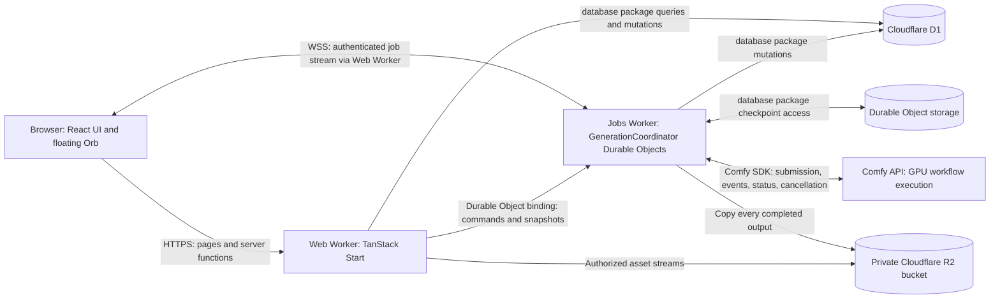

# Architecture

Status: agreed technology choices and implementation design. The repository now contains the initial Bun workspace scaffold, a TanStack Start studio shell, a private jobs Worker, and shared contracts/database/Comfy packages. The local generation MVP now implements durable acceptance, SDK polling, cancellation, versioned D1 projections, permanent R2 output storage, WebSocket snapshots, and the floating Orb. Jobs run as Router model requests or as ComfyUI graph submissions to Comfy Cloud (LTX graphs, revision modes, and media steps such as the background lock). The browser measures clips, draws posters, and converts non-square pixels with Mediabunny (WebCodecs) in a Web Worker. See [generation implementation](docs/generation-mvp.md) for current limits, local-only session behavior, and Router model support. The broader production lifecycle below remains the target architecture. See [README.md](README.md) for implemented boundaries, local commands, and outstanding integration work. Documentation references were checked on 2026-10-16.

## System overview

The application is a TypeScript, Bun-workspace monorepo. A TanStack Start web application runs on Cloudflare Workers. Cloudflare R2 stores generated asset bytes. Cloudflare D1 stores application records and R2 object references, with Prisma providing typed database access through a dedicated database package. Cloudflare Durable Objects own generation job orchestration and publish live job updates to the browser over WebSockets.

Comfy Router executes hosted model requests, and Comfy Cloud executes the app's own ComfyUI graphs, both on external GPU infrastructure. Durable Objects submit, monitor, reconcile, and cancel those executions through the official TypeScript SDK. Generation must continue independently of the initiating HTTP request, browser tab, and WebSocket connection.



## Technology decisions

| Concern | Choice | Responsibility |
| --- | --- | --- |
| Language | TypeScript with strict checking | Application, contracts, persistence APIs, and job orchestration |
| Monorepo | Bun workspaces | Dependency installation, workspace linking, and task execution |
| Web framework | TanStack Start with React and TanStack Router | Routing, rendering, server components, server functions, and HTTP endpoints |
| Styling | Tailwind CSS and shadcn/ui | Design tokens, layout, and application-owned UI components |
| Job indicator | shadercn `Orb29` | Floating indicator with `idle` and `thinking` states |
| Build and deployment | Vite, Cloudflare Vite plugin, Wrangler | Workers-compatible builds, local runtime, bindings, and deployment |
| Application hosting | Cloudflare Workers | Web application and Durable Object deployment entry points |
| Relational persistence | Cloudflare D1 | Users, workflows, generation history, and output metadata |
| Generated media | Cloudflare R2 | Durable, application-owned output bytes served through the web Worker |
| ORM | Prisma with `@prisma/adapter-d1` | Typed D1 access confined to `packages/database` |
| Job coordination | SQLite-backed Cloudflare Durable Objects | Durable execution state, scheduling, concurrency, and live subscriptions |
| Comfy integration | Official `@comfyorg/sdk` TypeScript package | Workflow submission and execution monitoring |
| Live transport | Browser WebSockets terminating in Durable Objects | Application job snapshots and updates |

Bun is the development toolchain, not the production server runtime. Deployed code runs in Cloudflare's Workers runtime. Runtime dependencies must be compatible with that environment; enabling Node compatibility does not establish compatibility with every Node package. Follow the [Cloudflare TanStack Start integration](https://developers.cloudflare.com/workers/framework-guides/web-apps/tanstack-start/) and validate the final dependency combination in `workerd`.

## Repository and package boundaries

```text
/
├── apps/
│   ├── web/
│   │   ├── src/
│   │   │   ├── routes/                 # Pages and explicit HTTP/WS endpoints
│   │   │   ├── components/             # App UI, shadcn components, Orb wrapper
│   │   │   ├── features/               # Workflow editing, generation, history
│   │   │   └── server/                 # Server functions, auth, request services
│   │   ├── vite.config.ts
│   │   └── wrangler.jsonc
│   └── jobs/
│       ├── src/
│       │   ├── index.ts                # Worker exports and DO registration
│       │   ├── generation-coordinator.ts  # State transitions, scheduling, recovery
│       │   ├── asset-resolver.ts       # Provider inputs from R2, signed media links
│       │   ├── media.ts                # Cloud media steps (lock, conform, square)
│       │   └── mentions.ts             # @mention resolution at acceptance
│       └── wrangler.jsonc
├── packages/
│   ├── database/
│   │   ├── prisma/                     # Prisma data model and generation config
│   │   ├── migrations/                 # Ordered D1 SQL migrations
│   │   └── src/
│   │       ├── client.ts               # Private Prisma/D1 initialization
│   │       ├── generated/              # Generated Prisma client; internal only
│   │       ├── queries/                # All persistence reads
│   │       │   ├── jobs.ts
│   │       │   ├── workflows.ts
│   │       │   └── coordinator.ts      # DO checkpoint reads
│   │       ├── mutations/              # All persistence writes
│   │       │   ├── jobs.ts
│   │       │   ├── workflows.ts
│   │       │   └── coordinator.ts      # DO checkpoint writes and recovery schedule
│   │       └── durable/               # Versioned DO record codecs/upgrades
│   ├── assets/
│   │   └── src/                        # Server-only R2 archival and streaming delivery
│   ├── comfy/
│   │   └── src/                        # Server-only SDK adapter and event mapping
│   └── contracts/
│       └── src/                        # DTOs, runtime validation, job/WS schemas
├── docs/
├── ARCHITECTURE.md
├── package.json                        # private; workspaces: apps/*, packages/*
└── bun.lock
```

The two applications are deployment units. The web Worker serves the public origin; the jobs Worker owns the Durable Object namespace and has no public application API. The web Worker accesses its objects through a cross-Worker Durable Object binding. Packages are shared libraries, not independently deployed services.

- `apps/web` owns presentation, authentication, authorization, request validation, and ordinary application operations. It may import the public database APIs and contracts, but must not execute generation through the Comfy SDK.
- `apps/jobs` owns all long-running Comfy SDK operations, job state transitions, scheduling, and WebSocket delivery. It imports the database, Comfy, assets, and contracts packages.
- `packages/database` owns **all database schemas, migrations, queries, and mutations**, including persistence helpers for Durable Object checkpoints. Prisma is used for D1; DO storage uses Cloudflare's native storage API behind the same package boundary.
- `packages/assets` owns blob transfer and R2 delivery. It has no database or Comfy SDK dependency; callers supply authorized output metadata and a provider URL resolver. Relational metadata and checkpoint writes remain exclusively in `packages/database`.
- `packages/comfy` wraps the SDK behind application-oriented methods. It has no database or UI dependencies. It maps provider responses to contracts without deciding job persistence or retry policy.
- `packages/contracts` contains browser-safe types and validators. It has no Prisma, Cloudflare binding, SDK, or React dependency.

Dependencies flow from applications to packages. Packages never import application code. Use explicit package exports and `workspace:*` dependencies; prohibit private deep imports. Keep the UI in `apps/web` until another application actually needs a shared UI package.

## Web application and server execution

Use server components for server-rendered, data-backed UI. Use TanStack Start **server functions** for callable backend operations and **server routes** where an explicit HTTP endpoint is required, including the WebSocket upgrade route. These are separate responsibilities: rendering a component must not submit a generation or perform another side effect.

TanStack Start currently documents server components as experimental and requiring explicit setup. Preserve the server-component direction, but validate its Vite/Cloudflare integration before building the application shell. The documented RSC setup requires React 19+ and Vite 8+; pin a tested combination when scaffolding. See [TanStack server components](https://tanstack.com/start/latest/docs/framework/react/guide/server-components).

Server functions authenticate the caller, validate input, enforce ownership, and invoke a database operation or Durable Object command. Route loaders may call these functions; a loader alone is not a server-only boundary. Database clients, credentials, and Comfy integration code must be excluded from browser bundles through explicit server boundaries and import restrictions. See [server functions](https://tanstack.com/start/latest/docs/framework/react/guide/server-functions) and the [execution model](https://tanstack.com/start/latest/docs/framework/react/guide/execution-model).

Job submission returns an application job ID and accepted state after durable acceptance. It never waits for image or video generation to finish. Reads and writes unrelated to long-running generation remain in the web application's server layer.

## Persistence ownership and consistency

### Database package API

Expose named operations such as `getWorkflow`, `listJobs`, `getJob`, `createWorkflow`, and `applyJobSnapshot`. Construct an opaque database context from the injected D1 binding; keep Prisma clients and model delegates private. Consumers must not call Prisma, execute SQL, or use D1 bindings directly.

`queries/` contains read operations. `mutations/` contains writes, conditional transitions, and atomic persistence operations. Each operation accepts explicit ownership scope and returns a contract DTO rather than leaking generated ORM types. Server authorization establishes the scope; database predicates enforce it on every scoped read and write.

The initial logical records are:

| Record | Required information |
| --- | --- |
| User | Stable identity used to scope records and coordinator routing |
| Workflow | Owner, name, version, API-format graph, timestamps |
| Generation job | Application ID, owner, workflow/input snapshot, state, state version, idempotency key, request hash, provider job ID, timestamps, and sanitized error |
| Job output | Job ID, provider asset identifier, media type, dimensions/duration where available, R2 object key, byte size, and ETag |

Index job history by owner and creation time, and outstanding work by owner and state. Enforce uniqueness of the application idempotency key within its owner scope. Store the immutable workflow/input snapshot used for each job so subsequent workflow edits cannot alter its meaning.

### D1 and Durable Object storage

D1 is the durable application catalog and historical read model. The owning Durable Object is authoritative for a job's execution state and live snapshot. Its storage contains the accepted command, immutable inputs, provider identifiers, retry/deadline information, monotonic versions, and pending D1 synchronization records.

For each transition, atomically persist the coordinator checkpoint and pending projection update locally, then apply the update to D1 through `mutations/`. D1 updates are idempotent and conditional on version so delayed updates cannot overwrite newer state. Clear a pending update only after D1 confirms it. A persisted alarm retries pending synchronization even when no browser is connected.

There is no distributed transaction spanning D1, Durable Object storage, R2, and Comfy. D1 history can briefly lag the live coordinator snapshot. The UI uses coordinator state for active jobs and includes the new job immediately after acceptance. Do not acknowledge acceptance until both the command and its recovery schedule are durable; a failed response can be retried using the same application key.

### Migrations

Keep the Prisma model, client generation, migration tooling, and all ordered D1 SQL files in `packages/database`. Generate and review D1-compatible SQL using the tooling supported by the pinned Prisma version, then apply it through Wrangler's D1 migration runner. Both applications point their D1 `migrations_dir` to this one directory; one release step applies migrations. Do not assume the standard Prisma database migration deployment path applies to D1. See [Prisma's D1 integration](https://www.prisma.io/docs/orm/overview/databases/cloudflare-d1) and [D1 migrations](https://developers.cloudflare.com/d1/reference/migrations/).

Database operations must use atomic primitives supported by the pinned D1 adapter; do not assume interactive Prisma transactions are available. Keep any required native D1 batch or SQL fallback inside `packages/database`.

Durable Object class registration belongs in the jobs Worker's Wrangler configuration using SQLite-backed classes. This deployment metadata is separate from database schema migrations. Versioned DO persistence records and their upgrade logic belong in `packages/database`.

## Generation orchestration

### Coordination scope

The initial design uses one `GenerationCoordinator` Durable Object per authenticated user. The server derives its deterministic name from the authenticated user ID. This gives each user a bounded job queue and one live stream covering all their jobs, including jobs started in another tab. Object names and job IDs are identifiers, not authorization credentials.

Each coordinator limits accepted queue length and in-flight submissions. Provider-wide limits remain a separate constraint: per-user limits do not enforce a shared Comfy account quota. Configure conservative admission limits and handle provider backpressure; introduce shared capacity coordination only if required by the selected deployment.

### Submission and execution

1. The browser sends a generation command with a stable client-generated idempotency key. Retries reuse the same key.
2. A server function authenticates the caller, validates workflow/input access, and routes the command to the user's coordinator.
3. The coordinator deduplicates by owner and key, rejects key reuse with different input, and durably records the job and next wake-up before acknowledging acceptance.
4. Scheduled processing moves the job to `submitting`, persists a provider submission key, and invokes the Comfy adapter. It stores the returned provider job ID immediately.
5. The coordinator monitors provider progress, normalizes events, persists state, updates the D1 projection, and broadcasts application events.
6. On confirmed provider completion, it checkpoints every output descriptor and enters `persisting`. Durable alarms copy the bytes into R2, checkpoint each completed copy, and project the references into D1.
7. Only after every output is stored does the job enter `succeeded`. The browser serves the saved assets from our origin and the aggregate Orb returns to Idle if no other jobs are active.

Only the owning coordinator changes execution state. Async handlers may interleave: use persisted versions, short local transactions, and attempt tokens to reject stale completions. Do not hold initialization/concurrency locks across external network calls.

### Job states

| State | Meaning | Orb contribution |
| --- | --- | --- |
| `queued` | Durably accepted, waiting for admission | Thinking |
| `submitting` | Provider submission in progress | Thinking |
| `running` | Provider execution or result collection in progress | Thinking |
| `persisting` | Provider finished; output bytes are being saved to R2 | Thinking |
| `cancelling` | Cancellation requested, provider outcome unresolved | Thinking |
| `succeeded` | Provider success confirmed and every output durably stored in R2 | Idle |
| `failed` | Definitive failure; no further automatic processing | Idle |
| `cancelled` | Confirmed cancellation, or removed before submission | Idle |
| `needs_attention` | Ambiguous outcome; automatic submission suspended | Idle, with a separate visible alert |

Normal execution is `queued → submitting → running → persisting → succeeded`. Definitive errors transition to `failed`. Submitted jobs pass through `cancelling`; completion may win a cancellation race. `needs_attention` is a suspended, unresolved state, not a terminal success or proof that provider execution stopped. Recovery must reconcile the original execution before resuming it. An intentional rerun creates a new application job.

### Durability and recovery

An open connection or unresolved promise is not a durable scheduler. Persist enough state to resume after object eviction, restart, or deployment, and use alarms for bounded reconciliation steps. Maintain one earliest-due alarm per coordinator across its jobs and pending D1 updates. Alarm handlers must be safe to run more than once. See [Durable Object lifecycle](https://developers.cloudflare.com/durable-objects/concepts/durable-object-lifecycle/) and [alarms](https://developers.cloudflare.com/durable-objects/api/alarms/).

Prefer submit-then-monitor SDK operations over a single uncheckpointed call that waits for the whole job. Rehydrate known provider jobs after restart; reconnect event monitoring and query authoritative status. Upstream live events may be missed, so correctness cannot depend on receiving every progress event.

Use bounded retries with backoff and jitter for safe reads and definitive retryable failures. Persist attempt counts, next-attempt times, and deadlines. A monitoring timeout must not falsely claim provider execution stopped; unresolved submissions move to `needs_attention`.

The MVP uses Router queued model requests (`comfy.models.submit` / `comfy.models.handle`). Persist the exact model/input and idempotency key before submission, then persist the request ID before polling. Router replays acceptance for the same key: bounded retries recover a lost receipt using identical input and key. Never mint a replacement key during recovery. A provider discriminator keeps the separate policy for Cloud graph submissions: workflow submission keys reject duplicates, so ambiguous workflow submissions without receipts remain suspended. See the [Comfy SDK submission contract](https://docs.comfy.org/development/api-development/sdks#retrying-a-submit-the-idempotency-key).

### Comfy runtime boundary

Router status is polled in bounded SDK calls from durable alarms; our browser-facing transport is WebSocket. A Router `COMPLETED` response can carry failure or cancellation in `error_type`, including in the result body; completion alone is not success. The adapter converts between provider events and application contracts. The SDK documents Node 22+, so Workers compatibility is an implementation gate: test submission, event consumption, rehydration, cancellation, and asset access in `workerd`. Use in-memory graphs and byte/stream APIs rather than filesystem helpers. See the [TypeScript SDK reference](https://github.com/Comfy-Org/comfy-typescript-sdk).

### Asset storage, delivery, and retention

**Every generated asset is application-owned data and must be copied into a private R2 bucket. Provider URLs are temporary ingestion sources, never permanent output references or browser delivery URLs.** Comfy Router request expiry must not remove access to assets already saved by Open Cinema.

The `GENERATED_ASSETS` binding in both Workers identifies the same environment-specific bucket. The jobs Worker writes; the web Worker reads. Keep the bucket private: no public `r2.dev` URL or unauthenticated custom-domain access. Local development uses persisted local R2; preview and production require separately provisioned buckets. The configured development name is `open-cinema-generated-assets`.

`JobOutput` owns the R2 object reference because a job can produce multiple assets. Store `r2Key`, `sizeBytes`, `etag`, and `mediaType` alongside its job ID and provider asset identifier. The bucket is deployment configuration, not an expiring URL embedded in a row. New completed outputs require non-null storage metadata; nullable columns exist to migrate historical provider-only records. D1 and DO checkpoints store metadata, never image/video bytes or signed source URLs.

Use deterministic, owner/job/output-scoped object keys under `generated/v1/`. Check for an already-completed object before contacting Comfy. Copy with bounded memory and checkpoint progress per asset. A crash after R2 completion but before the checkpoint is acknowledged is recovered by inspecting that same key. Never regenerate to recover a storage failure. R2, D1, and DO storage have no distributed transaction: pending D1 projections retry independently, and old projections cannot erase a stored reference.

The current transfer implementation uses 5 MiB multipart buffers, a 512 MiB per-asset safety bound, a 60-second source transfer deadline, and one asset per alarm. It validates HTTPS source hosts and redirects, never forwards Comfy credentials to asset hosts, rejects incomplete bodies and unsupported media types, and aborts incomplete multipart uploads on handled failures. Configure an R2 lifecycle rule to abort orphaned multipart uploads; **do not expire completed generated objects**. Larger assets or transfers need a resumable transfer design before enabling models that exceed these limits. Provider adapters must enumerate every output; transfer failure must remain visible rather than silently dropping assets.

Storage retries use persisted backoff and a 15-minute initial archival deadline. Exhausted retries become `needs_attention` with a storage-specific message. Check again resumes saving the original outputs; it never starts another provider execution. The UI labels `persisting` as Saving and keeps the Orb Thinking. Cancellation cannot discard outputs once provider completion is known.

The authenticated same-origin `/api/jobs/output` endpoint resolves ownership through the database package, with the coordinator as a fallback while D1 catches up. It streams R2 bytes directly and supports HEAD, ETag revalidation, and single byte ranges. It never redirects to Comfy or calls the provider to serve an archived asset. Storage keys are identifiers, not authorization tokens. Responses use private caching and `nosniff`.

Checkpoint schema v4 upgrades existing successful provider-only jobs to `persisting` on coordinator activation and schedules archival. Dormant coordinators require activation or a future administrative sweep. Already-expired sources cannot be reconstructed by this migration; report them as needing attention. Do not claim historical assets are migrated until their R2 references have been written.

Completed assets have no automatic expiry. Product deletion and retention controls must explicitly coordinate object deletion with catalog references; never use provider-job expiry or coordinator cleanup as a signal to delete an R2 object. Backup/recovery policy and user-directed deletion remain separate operational work.

R2 API behavior follows the [Workers R2 binding reference](https://developers.cloudflare.com/r2/api/workers/workers-api-reference/).

## WebSocket protocol and UI synchronization

Expose a same-origin `GET /api/jobs/stream` upgrade endpoint in the web Worker. Authenticate the session, validate the request origin, derive the user scope, and forward the upgrade to that user's coordinator. The Durable Object accepts and owns the connection using Cloudflare's WebSocket Hibernation API. Do not expose Comfy credentials or trust a user ID supplied in the URL. See [Durable Object WebSockets](https://developers.cloudflare.com/durable-objects/best-practices/websockets/).

Define a versioned, runtime-validated protocol in `packages/contracts`. Each event carries `protocolVersion`, `type`, `sequence`, and `emittedAt`; job events also carry `jobId`, `jobVersion`, and their typed payload. Initial event types are `snapshot`, `job.updated`, `job.output`, and `error`.

- On connection, send an authoritative snapshot with all nonterminal jobs, including suspended jobs, and a sequence watermark. Register the subscriber and establish the snapshot ordering without losing concurrent updates.
- Persist the stream sequence across object restarts. Send updates only after the corresponding coordinator state is durable.
- Reconnect with exponential backoff and jitter. Always refresh the snapshot; the protocol does not promise replay of every event.
- Ignore duplicate/older job versions. On an unexplained sequence gap or incompatible protocol version, resynchronize rather than guessing state.
- Coalesce frequent progress updates before assigning sequence numbers. Bound message size and buffered output; disconnect slow clients so they can recover from a snapshot.
- Keep connection health separate from job state. A dropped socket neither cancels a job nor changes it to idle. Use a server snapshot fallback while the stream is unavailable.

Use HTTP server functions for submit/cancel commands initially; the socket is a status subscription. Persist only bounded connection metadata needed for hibernation recovery. Authenticate again on reconnect and expire or close subscriptions when their session authorization expires.

Hibernation applies to accepted browser sockets. Active upstream I/O may keep the object resident; incoming socket hibernation is not a guarantee that a coordinator monitoring Comfy consumes no active runtime.

## Floating Orb

Mount one floating `GenerationOrb` in the authenticated application shell so it survives route changes. Wrap [shadercn Orb 29](https://www.shadercn.run/docs/components/orbs/orb-29) and derive its state from the shared job subscription:

```ts
const thinkingStates = new Set(['queued', 'submitting', 'running', 'persisting', 'cancelling']);
const orbState = jobs.some((job) => thinkingStates.has(job.state))
  ? 'thinking'
  : 'idle';
```

Compute this over all jobs for the authenticated user, not just the visible page or most recent request. One completed job must not stop the animation while another is active. `needs_attention` produces a visible alert and recovery action outside the binary animation state.

Render the shader on the client with a stable fallback during server rendering. Until the first authoritative snapshot arrives, show synchronization status rather than asserting there are no jobs. Preserve the last known activity state during reconnects and label stale status. Provide accessible text, respect reduced motion, and keep the job list usable if shader rendering is unavailable. Selecting the Orb opens the job activity panel.

## Configuration, deployment, and verification

Use one root Bun lockfile and pin the Bun version, dependency versions, and Workers compatibility date. Root scripts delegate to workspace tasks for development, build, type checking, testing, and database migrations. Local development runs both Workers with their bindings and isolated local storage.

The web Worker receives D1 and the jobs Durable Object namespace binding. The jobs Worker receives D1, its namespace, the approved Comfy endpoint configuration, and Comfy credentials through Worker secrets. Keep environment credentials out of contracts and browser bundles. Production and preview deployments use separate D1 databases, namespaces, and secrets.

Apply backward-compatible database migrations before deploying code that requires them. Deploy the jobs Worker before web changes that depend on new RPC or event contracts. Coordinate contract versions so older tabs can reconnect or request a refresh. Code rollback does not roll back stored data; evolve checkpoint formats compatibly.

Log structured request IDs, application job IDs, provider job IDs, state transitions, retry counts, and sanitized failures. Measure queue wait, generation duration, synchronization lag, reconnect rate, and unresolved submissions. Do not log credentials, raw assets, or full user prompts by default.

Implementation verification must cover ownership isolation, duplicate submissions, ambiguous provider acceptance, restart recovery, repeated alarms, delayed D1 writes, cancellation races, WebSocket reconnects, and aggregate Orb state with concurrent jobs. Run Cloudflare integration tests in the Workers runtime and browser tests for the complete submit-to-result path.

Before scaffolding is considered complete, resolve and validate:

1. The pinned TanStack RSC/Vite/Cloudflare and Prisma/D1 combinations.
2. SDK compatibility in Durable Objects against the selected Comfy hosting target.
3. Authentication/session implementation and provider-wide generation capacity.
4. User-directed media deletion, backup/recovery policy, and production R2 provisioning.

These are implementation gates and remaining product choices; they do not change the selected Bun, TanStack Start, Workers, Durable Objects, D1, and Prisma architecture.
