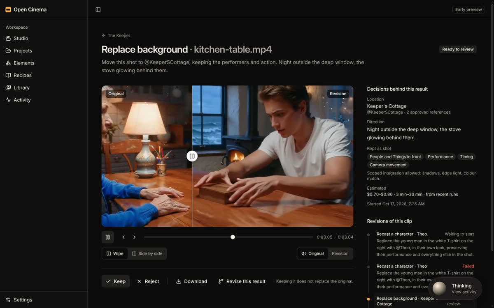
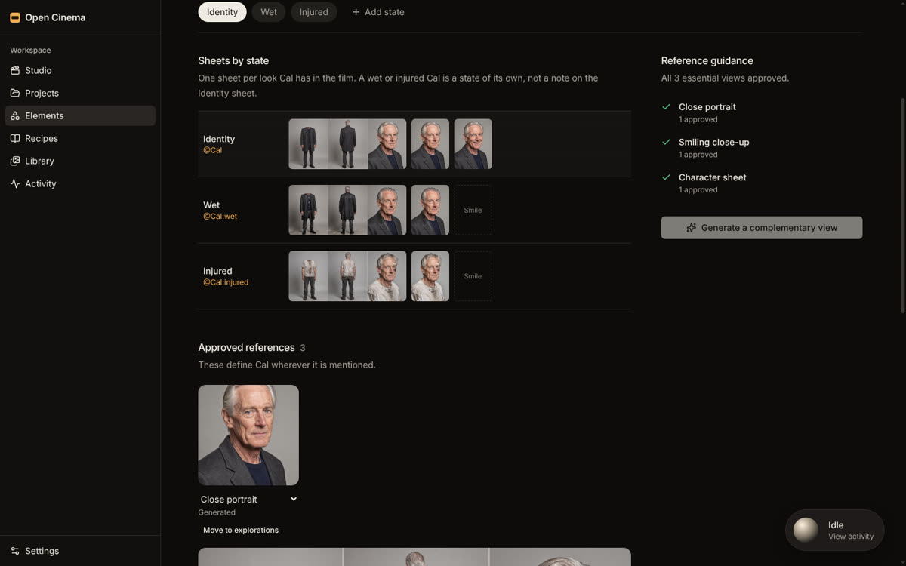
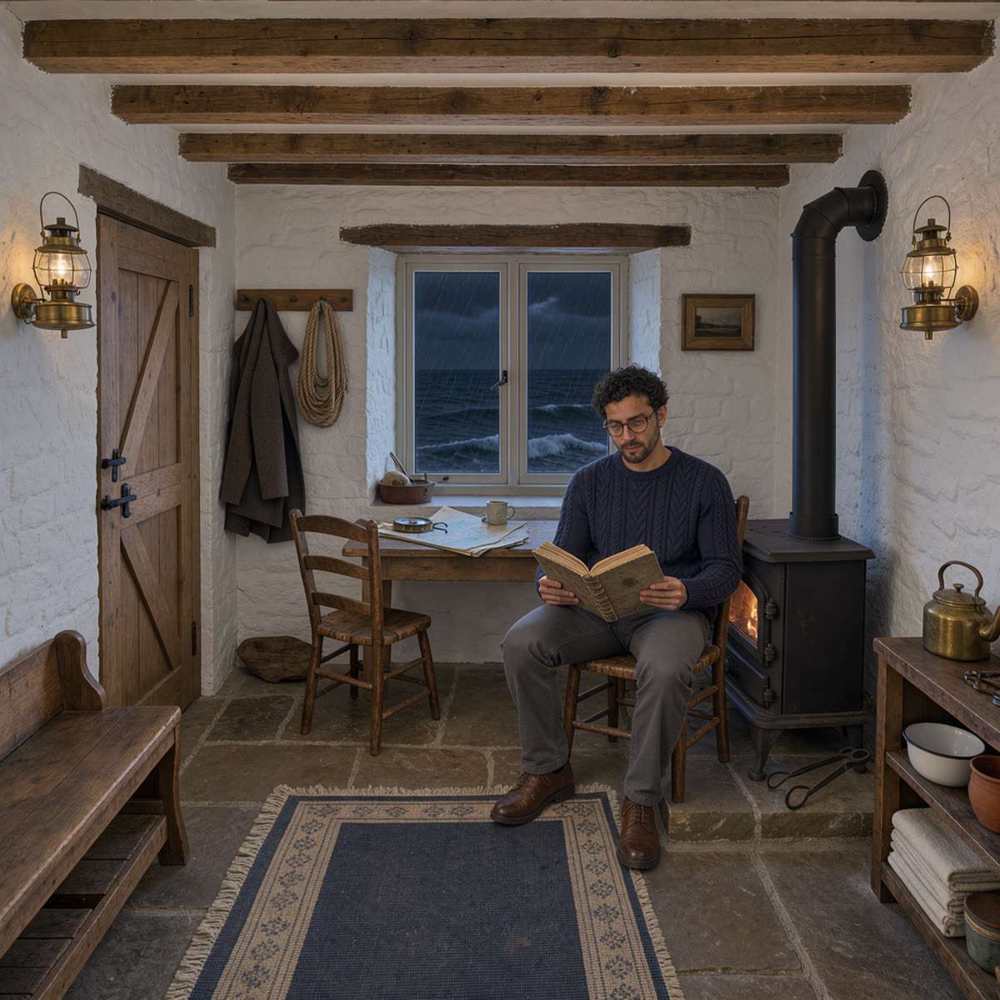
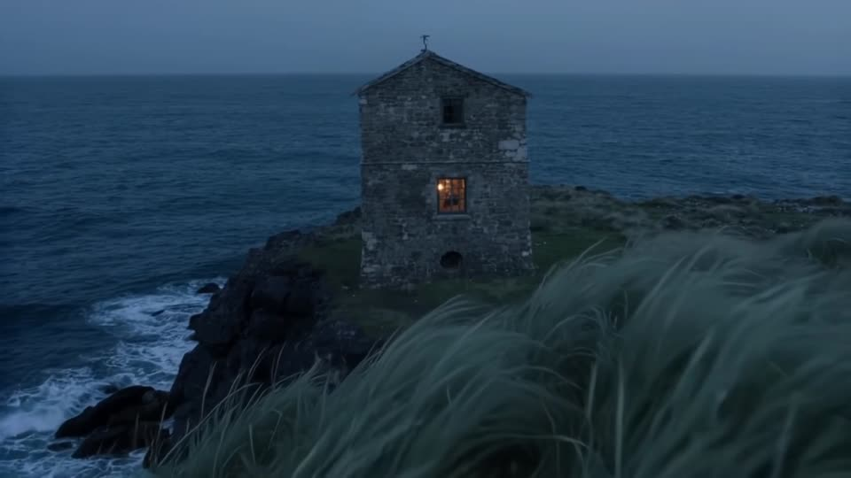

# Open Cinema

An open creative studio for images, films and reusable worlds, built on the [Comfy Developer Platform](https://docs.comfy.org/development/overview). Describe an idea, explore directions, save the people, places and things that work as **Elements**, and keep directing the same world across stills and video. Complexity lives in Comfy workflows; the studio keeps your attention on the picture.

Open Cinema is an early preview and our entry to Comfy's [Open Source Higgsfield](https://comfy.org/open-source-higgsfield) competition. Product direction lives in [GOALS.md](GOALS.md) and [PRODUCT.md](PRODUCT.md); the roadmap is [issue #2](https://github.com/martinnormark/open-cinema/issues/2).

## What you can do today

- **Generate images and video** from a written idea: FLUX 3 images, LTX 2.5 text-to-video and FLUX 3 image-to-video through Comfy Router, and LTX-2 camera moves on Comfy Cloud. Live progress survives reloads, closed tabs and dropped connections.
- **Build Elements**: Characters, Locations and Things with approved references, Character sheets, and states such as `@Cal:wet` that a prompt can mention.
- **Keep a media library** of uploads and results, all copied into your own R2 storage before a job is marked ready.
- **Revise a take** in the revision studio: replace its background, recast a person as a Character, swap an object (Object Swap), restyle it, or re-stage the camera, then compare original and result before keeping it.
- **Direct a project** with a persistent look and per-shot direction, and save what works as **Recipes**.
- **Plan Sequences** of shots from a rough idea, and move Elements, Recipes, a project's look and Sequences between projects or installations as a **World** bundle.
- **Follow every job** in Activity or from the floating Orb, cancel work in flight and recover jobs that need attention.

Performance transfer runs as a graph but has no composer in the studio yet; see the roadmap for status.

## Example outputs

Every result below is a real Comfy generation from this repository's workflows, made on 2026-10-17; nothing is retouched. Watch the [two-minute demo](docs/media/open-cinema-demo.mp4) for the same journey in motion.


**One take, two revisions.** The source clip, its background replaced with the @KeepersCottage Location, and the young man recast as @Theo. Performance, timing and camera move stay as shot. Both revisions by Kling 3.0 Omni through Comfy Router.


**Background replacement that never repaints the actors.** LTX 2.5 with the Alpha Gen IC-LoRA, run as a ComfyUI graph on Comfy Cloud, pulls a frame-aligned matte from the take and composites the original pixels over a new plate made with FLUX 3.



**Compare before you keep.** The revision viewer plays original and result in sync with a wipe or side by side, lists the decisions behind the result, and keeps the original one click away.



**One character, every state.** @Cal, @Cal:wet and @Cal:injured each carry their own sheet of full-body views, close portrait and smile, so a scene can ask for exactly the look it needs. Generated with FLUX 3 Image.

[](docs/media/examples/elements-theo-in-cottage.jpg)

**Elements by mention.** "@Theo at @KeepersCottage" renders from the two Elements' four approved references, not from a description. FLUX 3 Image.

[](docs/media/examples/ltx-2-5-text-to-video.mp4)

**Video from the Studio.** A six-second, 720p clip with sound from the Studio's Video mode (click to play). LTX 2.5 Fast through Comfy Router.


**Performance transfer (experimental).** A FLUX 3 keyframe of a new character driven by the source's pose, with LTX 2.3 Union Control on Comfy Cloud. The graph ran on its own; the composer for it is not built yet. See [docs/performance-transfer.md](docs/performance-transfer.md).

## Run it locally

You need:

- [Bun](https://bun.sh) **1.4.2** and [Node.js](https://nodejs.org) **24+** (Node runs the dev tooling; production runs on Cloudflare Workers).
- A **Comfy API key** from [platform.comfy.org](https://platform.comfy.org) with Router credits and Comfy Cloud access. Router bills per request in credits (211 credits = $1). The LTX graphs (Alpha Gen background replacement, camera moves, Object Swap, Restyle, Re-stage) and media steps run on Comfy Cloud, so those need Cloud access too.
- No Cloudflare account. D1, R2 and Durable Objects are emulated locally.

```sh
git clone https://github.com/martinnormark/open-cinema.git
cd open-cinema
bun install --frozen-lockfile
```

Create the two local secret files from their examples. Both are gitignored.

```sh
cp apps/jobs/.dev.vars.example apps/jobs/.dev.vars
cp apps/web/.dev.vars.example apps/web/.dev.vars
```

1. In `apps/jobs/.dev.vars`, set `COMFY_API_KEY="…"` (keep the quotes). Only the private jobs Worker ever sees this key.
2. In `apps/web/.dev.vars`, set `LOCAL_SESSION_SECRET` to a random value of at least 32 characters, for example the output of `openssl rand -base64 48`. Leave `LOCAL_MVP_ENABLED=true`.

Then prepare the local database and start both Workers:

```sh
bun run setup
bun run dev
```

Open the URL Vite prints (normally <http://127.0.0.1:5173>), choose **Start local session**, write a prompt or pick **Surprise me**, and select **Generate image**. **Settings** shows whether your Comfy key and sign-in are configured.

If something is off:

| Symptom                                       | Fix                                                                                            |
| --------------------------------------------- | ---------------------------------------------------------------------------------------------- |
| "Local testing is not configured"             | Check `apps/web/.dev.vars`, and open the app on `127.0.0.1` or `localhost`, not a LAN address. |
| "Comfy Router credentials are not configured" | Set `COMFY_API_KEY` in `apps/jobs/.dev.vars` and restart `bun run dev`.                        |
| A job fails with a billing or access error    | Add credits to the workspace that owns the key on platform.comfy.org.                          |
| Database errors after pulling new code        | Run `bun run setup` again to apply new migrations.                                             |

## Deploy to Cloudflare

Open Cinema runs as two Workers: `open-cinema-web` (UI, server functions, sign-in) and the private `open-cinema-jobs` (Comfy calls, Durable Object coordinators, R2 archival).

1. **Create resources** for each environment:

   ```sh
   bunx wrangler d1 create open-cinema
   bunx wrangler r2 bucket create open-cinema-generated-assets
   ```

   Put the D1 `database_id` into **both** `apps/web/wrangler.jsonc` and `apps/jobs/wrangler.jsonc` (the all-zero IDs are local placeholders). Keep the bucket private and do not enable object expiry.

2. **Set up sign-in.** Public deployments refuse every request until real authentication is configured. Put the web Worker behind Cloudflare Access and set `AUTH_MODE`, `CF_ACCESS_TEAM_DOMAIN` and `CF_ACCESS_AUD` as described in [docs/auth.md](docs/auth.md).

3. **Add secrets**:

   ```sh
   bunx wrangler secret put COMFY_API_KEY --name open-cinema-jobs
   bunx wrangler secret put LOCAL_MVP_ENABLED --name open-cinema-web      # enter: false
   bunx wrangler secret put LOCAL_SESSION_SECRET --name open-cinema-web   # any random value; unused with Access
   ```

   Optional, on the jobs Worker: set the `MEDIA_PUBLIC_ORIGIN` variable to the studio's https origin and `MEDIA_SIGNING_SECRET` (a secret equal to the web Worker's `LOCAL_SESSION_SECRET`) so providers can fetch uploads through signed links ([docs/foundation.md](docs/foundation.md)). Set the `MAX_ACTIVE_JOBS` variable (1 to 4, default 1) to let one creator run more jobs at once.

4. **Apply migrations and build**:

   ```sh
   bunx wrangler d1 migrations apply open-cinema --remote --config apps/jobs/wrangler.jsonc
   bun run build
   ```

   `bun run dev` and `bun run build` first run `bun run models`, which downloads the on-device face and pose models the revision studio's checks use, so they need network access. A failed download only disables those checks.

5. **Deploy jobs first, then web**, using the configs Vite generates so the RSC environment and client assets are included:

   ```sh
   bunx wrangler deploy --config apps/web/dist/open_cinema_jobs/wrangler.json
   bunx wrangler deploy --config apps/web/dist/server/wrangler.json
   ```

Use separate D1 databases, buckets and secrets for preview and production. Nothing in this repository deploys automatically.

## Commands

| Command                    | Effect                                                      |
| -------------------------- | ----------------------------------------------------------- |
| `bun run setup`            | Generate Prisma and Worker types, apply local D1 migrations |
| `bun run dev`              | Run both Workers with Vite and hot reload                   |
| `bun run typecheck`        | Regenerate types and check all workspaces                   |
| `bun run test`             | Jobs integration tests in `workerd`, plus web unit tests    |
| `bun run build`            | Build client, SSR/RSC and jobs Worker artifacts             |
| `bun run preview`          | Serve the production build locally                          |
| `bun run check`            | Type-check, test and build                                  |
| `bun run db:migrate:local` | Apply committed migrations to local D1                      |
| `bun run format`           | Format code and configuration                               |

The build emits upstream RSC source-map warnings; they do not affect the output.

## How it is built

| Workspace            | Purpose                                                                  |
| -------------------- | ------------------------------------------------------------------------ |
| `apps/web`           | TanStack Start, React, Tailwind, shadcn/ui, server functions, sign-in    |
| `apps/jobs`          | Private Worker with a per-creator `GenerationCoordinator` Durable Object |
| `packages/contracts` | Browser-safe schemas for jobs, workflows, Elements and media             |
| `packages/database`  | Prisma schema, D1 migrations, queries and mutations                      |
| `packages/assets`    | Server-only R2 archival and authenticated streaming                      |
| `packages/comfy`     | Server-only adapter for the official Comfy TypeScript SDK                |

- The web Worker validates input and owns sessions; it never imports the Comfy adapter or sees the API key.
- A Durable Object per creator accepts idempotent commands, persists checkpoints and alarms, polls Comfy, and pushes authoritative snapshots over hibernatable WebSockets.
- All database access goes through `packages/database`. To change the schema, edit `packages/database/prisma/schema.prisma`, generate the next ordered SQL migration with the pinned Prisma tooling, then run `bun run db:generate`, `bun run db:migrate:local` and `bun run test`. Do not use `prisma migrate deploy` with D1.
- R2 holds generated bytes; D1 holds metadata only.

Read [ARCHITECTURE.md](ARCHITECTURE.md) before extending the app, and [AGENTS.md](AGENTS.md) for repository rules (60 fps UI, no direct `useEffect`, design skills).

## Documentation

- [Sign-in and public deployment](docs/auth.md)
- [Design system](docs/design.md)
- [Generation pipeline and verification](docs/generation-mvp.md)
- [Competition submission](docs/competition-submission.md) and [competition rules](docs/competition.md)
- [Comfy developer reference](docs/README.md)

## Known limitations

- Everyone allowed into a deployment shares its Comfy key and credits; there are no per-creator spending limits yet.
- The Orb29 activity shader carries a non-commercial restriction from its author (see [LICENSE](LICENSE)). Replace it or obtain permission before commercial use.
- Sustained 60 fps has been profiled in headless Chrome only, not yet on representative physical devices.

## License

[MIT](LICENSE), except third-party components noted in the license file.
