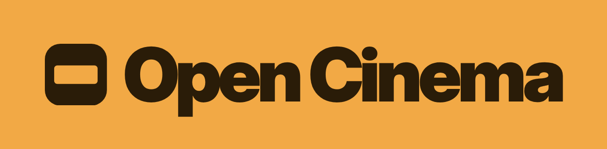

# Open Cinema



An open creative studio for images, films and reusable worlds, built on the [Comfy Developer Platform](https://docs.comfy.org/development/overview). Describe an idea, explore directions, save the people, places and things that work as **Elements**, and keep directing the same world across stills and video. Complexity lives in Comfy workflows; the studio keeps your attention on the picture.

Open Cinema is an early preview and our entry to Comfy's [Open Source Higgsfield](https://comfy.org/open-source-higgsfield) competition. Product direction lives in [GOALS.md](GOALS.md) and [PRODUCT.md](PRODUCT.md); the roadmap is [issue #2](https://github.com/martinnormark/open-cinema/issues/2).

## What you can do today

- **Generate images and video** from a written idea: FLUX 3 images, LTX 2.5 text-to-video and FLUX 3 image-to-video through Comfy Router, and LTX-2 camera moves on Comfy Cloud. Live progress survives reloads, closed tabs and dropped connections.
- **Build Elements**: Characters, Locations and Things, each made one step at a time from an anchor view (a close portrait, an establishing view, a hero view) into a reference sheet, with Character sheets, Thing turnarounds, and states such as `@Cal:wet` that a prompt can mention.
- **Keep a media library** of uploads and results, all copied into your private media storage before a job is marked ready.
- **Revise a take** in the revision studio: replace its background, recast a person as a Character (experimental and outside the MVP; see [known limitations](docs/known-limitations.md)), swap an object (Object Swap), restyle it, or re-stage the camera, then compare original and result before keeping it.
- **Copy the moves** from any clip, a dance, a stunt or a gesture, onto one of your Characters, in the clip's place or one of your Locations, with Wan 3.0 on Comfy Router or the open-weights Wan Animate 2 on Comfy Cloud. Click people or things on a frame to say who becomes whom; SAM 3.1 tracks each of them through the clip in a Comfy Cloud graph that runs Wan 3.0 ([docs/copy-the-moves.md](docs/copy-the-moves.md)).
- **See which model made what.** Every mode names its model, maker, open or hosted weights and where it runs before you generate, and every result and Activity entry says "Made with" the same.
- **Direct each shot** with a look and directing choices, and save what works as **Recipes**.
- **Plan Sequences** of shots from a rough idea, and move Elements, Recipes and Sequences between installations as a **World** bundle.
- **Follow every job** in Activity or from the floating Orb, cancel work in flight and recover jobs that need attention.

## Example outputs

Every result below is a real Comfy generation from this repository's workflows, made on 2026-10-17; nothing is retouched. Watch the [two-minute demo](docs/media/open-cinema-demo.mp4) for the same journey in motion.


**One take, two revisions.** The source clip, its background replaced with the @KeepersCottage Location, and the young man recast as @Theo. Performance, timing and camera move stay as shot. Both revisions by Kling 3.0 Omni through Comfy Router.


**Background replacement that never repaints the actors.** LTX 2.5 with the Alpha Gen IC-LoRA, run as a ComfyUI graph on Comfy Cloud, pulls a frame-aligned matte from the take and composites the original pixels over a new plate made with FLUX 3.


**Compare before you keep.** The revision viewer plays original and result in sync with a wipe or side by side, lists the decisions behind the result, and keeps the original one click away.


**One character, every state.** @Cal, @Cal:wet and @Cal:injured each carry their own sheet of full-body views, close portrait and smile, so a scene can ask for exactly the look it needs. Generated with FLUX 3 Image.

[](docs/media/examples/elements-theo-in-cottage.jpg)

**Elements by mention.** "@Theo at @KeepersCottage" renders from the two Elements' four approved references, not from a description. FLUX 3 Image.

[](docs/media/examples/ltx-2-5-text-to-video.mp4)

**Video from the Studio.** A six-second, 720p clip with sound from the Studio's Video mode (click to play). LTX 2.5 Fast through Comfy Router.


**Performance transfer, first attempt.** A FLUX 3 keyframe of a new character driven by the source's pose, with LTX 2.3 Union Control on Comfy Cloud. Faces drifted, so it was replaced by [Copy the moves](docs/copy-the-moves.md) on Wan 3.0 and Wan Animate 2. See [docs/performance-transfer.md](docs/performance-transfer.md).

## Run with Docker

```sh
cp .env.example .env
# Add your Comfy API key to .env to enable generation.
docker compose up --build -d
```

Open http://localhost:3000. One container runs the web app and background jobs; a persistent Docker volume holds SQLite databases and private media. No external database, queue, storage, or identity service is needed. Comfy Router and Comfy Cloud remain the external generation providers.

`COMFY_API_KEY` supplies both providers, or set `COMFY_ROUTER_API_KEY` and `COMFY_CLOUD_API_KEY` separately. Every setting also accepts a `_FILE` path for mounted secrets. Keys are runtime-only and never included in the image or browser bundle. The app starts without provider keys.

For public hosting, use `AUTH_MODE=password`, set `BASIC_AUTH_PASSWORD`, and configure a TLS reverse proxy and `APP_ORIGIN`. This is a shared private studio account. See [deployment](docs/deployment.md) and [authentication](docs/auth.md).

The root `Dockerfile` also works with plain `docker build` and `docker run`. Compose requires no additional service images. Run only one instance per data volume. Rebuilds and restarts preserve work; deleting the volume does not.

## Local development

Install Bun **1.4.2** and Node.js **24+** (used by Prisma tooling). Then:

```sh
bun install --frozen-lockfile
cp .env.example .env
bun run setup
bun run dev
```

Vite runs on http://localhost:5173 and reads `.env`, then `.env.local` (git-ignored, for your keys), from the repository root; variables already set in the shell win. Development uses the same SQLite, file storage and coordinators as Docker, stored in `.data/`. Run the production build with `bun run build && bun run start` on port 3000.

The build prepares the on-device face/pose models used by revision checks. It downloads the pinned pose model when unavailable locally; if the download fails, those optional checks report unavailable.

## Commands

| Command                        | Effect                                                  |
| ------------------------------ | ------------------------------------------------------- |
| `docker compose up --build -d` | Build and start the complete persistent studio          |
| `bun run setup`                | Generate Prisma and apply local SQLite migrations       |
| `bun run dev`                  | Vite with hot reload and persistent background jobs     |
| `bun run typecheck`            | Regenerate Prisma and check all workspaces              |
| `bun run test`                 | SQLite/file-store job integration tests and web tests   |
| `bun run build`                | Build the client, SSR and RSC artifacts                 |
| `bun run start`                | Run the production Bun server; migrate and recover jobs |
| `bun run check`                | Type-check, test and build                              |
| `bun run db:migrate:local`     | Apply ordered SQLite migrations                         |
| `bun run format`               | Format code and configuration                           |

## How it is built

| Workspace            | Purpose                                                                  |
| -------------------- | ------------------------------------------------------------------------ |
| `apps/web`           | TanStack Start, React, Tailwind, shadcn/ui, server functions and sign-in |
| `apps/jobs`          | Persistent per-creator coordinators and job scheduling                   |
| `packages/contracts` | Browser-safe schemas for jobs, workflows, Elements and media             |
| `packages/database`  | Prisma/SQLite catalog, migrations and execution checkpoints              |
| `packages/assets`    | Private file storage and authenticated streaming                         |
| `packages/runtime`   | Runtime settings, mounted secrets and HTTP/WebSocket adapters            |
| `packages/comfy`     | Official Comfy SDK and workflow graph integration                        |

Jobs survive closed tabs and server restarts. Checkpoints and recovery times commit atomically; output files are archived before a job is marked ready. Browser updates travel over authenticated WebSockets. All database access stays in `packages/database`, and all application data stays on the data volume.

Read [ARCHITECTURE.md](ARCHITECTURE.md) before extending the app, and [AGENTS.md](AGENTS.md) for repository rules.

## Documentation

- [Sign-in and public deployment](docs/auth.md)
- [Design system](DESIGN.md)
- [Generation pipeline and verification](docs/generation-mvp.md)
- [Competition submission](docs/competition-submission.md) and [competition rules](docs/competition.md)
- [Comfy developer reference](docs/README.md)

## Known limitations

- Everyone allowed into a deployment shares its Comfy key and credits; there are no per-creator spending limits yet.
- Sustained 60 fps has been profiled in headless Chrome only, not yet on representative physical devices.

## License

[MIT](LICENSE), except third-party components noted in the license file.
